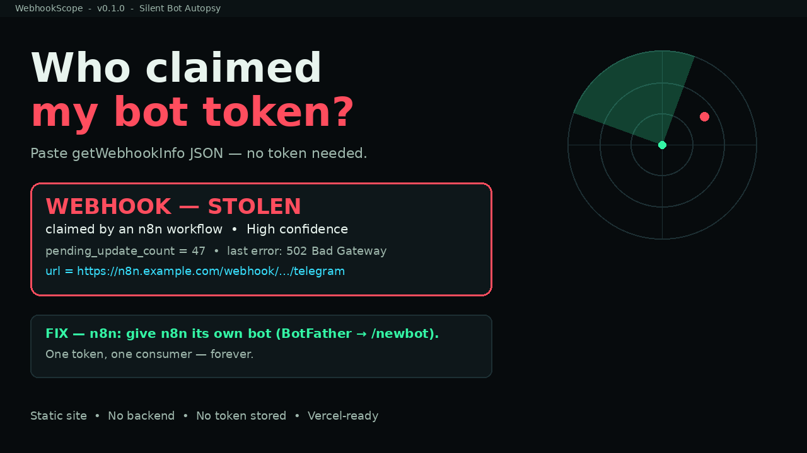

# WebhookScope — Who claimed my bot token?

[](https://github.com/BidyutRoy2/webhookscope/actions/workflows/ci.yml)
[](LICENSE)
[](CHANGELOG.md)
[](docs/vercel-deploy.md)



**Your Telegram bot went silent. The process is running, the logs look healthy — and its updates are going somewhere else. WebhookScope finds out who claimed your bot token, in seconds.**

> **Live demo:** deploy it on Vercel in one click (see [Deploy on Vercel](#deploy-on-vercel) below) — the live URL goes here once deployed. The demo runs entirely in the browser: no signup, no server, no token by default.
>
> 🎬 **Demo video:** [assets/demo.mp4](assets/demo.mp4) (18 s) — the 3-day silent bot, diagnosed in 10 seconds. GIF version: [assets/demo.gif](assets/demo.gif).

## What it is

A free, static, browser-only **Telegram Bot Update Flow Explorer** — in the lesson grammar of Protocol Explorer (animated flow + packet table + inspector), but for Telegram updates instead of network protocols, and with a killer feature nobody else has built: the **Silent Bot Autopsy**.

Telegram delivers a bot's updates to **one consumer only**: either `getUpdates` long polling or one webhook URL. Never both, never two pollers. When a second consumer claims the token — an n8n workflow, a stale deploy, a teammate's tunnel, a second copy of your own bot — your bot goes silent while looking perfectly healthy. That is the single most common cause of a silent bot (Conferbot, verified Aug 2026), and until now the only diagnosis was a raw JSON blob and a blog post telling you to "call `getWebhookInfo` twice".

## The killer feature — Silent Bot Autopsy

Paste your `getWebhookInfo` JSON (no token — that output contains no secret) and get:

1. **Verdict radar** — `POLLING — healthy` / `WEBHOOK — healthy` / `WEBHOOK — failing deliveries` / `WEBHOOK — STOLEN` / `SECOND POLLER suspected`, with a High / Medium / Low confidence badge and evidence bullets citing the exact fields.
2. **Claimant fingerprint** — from the webhook URL host + path + `ip_address`: n8n, OpenClaw, ngrok, Railway, Vercel, Render, Fly, Hookdeck / Hooklistener / webhooks.cc, or a generic VPS. Each match shows the pattern that fired, its confidence, and how to verify it. **Unknown hosts stay Unknown — never a guess.** Fingerprinting is probabilistic; Telegram publishes no "who set this webhook" API, and this tool says so on the page.
3. **Claim timeline** — sample again after a deploy; snapshots live in `localStorage` only, with a `pending_update_count` sparkline and URL-change events. The timeline is built by sampling *forward* — past claim times cannot be reconstructed from Telegram's API alone, and the page never invents a timestamp.
4. **409-variant branching** — paste a 409 line and it branches: `terminated by other getUpdates request` → second-poller checklist; `can't use getUpdates while webhook is active` → webhook-removal fix; `terminated by setWebhook request` → something just called `setWebhook`.
5. **Framework fix cards** — copyable fixes for **aiogram, python-telegram-bot, Telegraf, grammY, n8n, OpenClaw**. Every destructive fix defaults to **keeping** the backlog: `drop_pending_updates=true` discards up to 24 hours of queued updates.
6. **Optional live mode (collapsed, browser-only)** — paste a token and the page calls `api.telegram.org` directly from your browser. No server, nothing stored, field cleared after the check, with a revoke reminder.
7. **Export redacted report** — Markdown/JSON, hostnames only, no token — paste it into a GitHub issue or team chat.

**Demo, pre-filled above the fold:** *"The 3-day silent bot, diagnosed in 10 seconds"* — an n8n webhook URL, `pending_update_count: 47`, last error `502 Bad Gateway` dated 3 days ago → **STOLEN by an n8n workflow, High confidence**. Labelled DEMO, no real token. (Based on the Melardenio story, 13 Oct 2026: a Telegraf poller + an n8n Telegram Trigger sharing one token; the bot was quiet for three days.)

## Also in v0.1.0

- **Animated flow lesson** — long polling vs webhook, Play / Step / Reset, with a flow table (User → Telegram → Your bot → sendMessage).
- **Failure-injection playground** — flip a switch (second poller, webhook set elsewhere, handler 500, slow handler) and watch the simulated queue grow.
- **Paste-your-Update inspector** — decode any Update JSON field by field: type, matching handler, and the `sendMessage` it should produce.
- **Coming next (v2, not in v0.1.0):** Update Coverage X-Ray · Live Handler Trace · Time-Travel Replay.

## Quick start

No build step. No dependencies. No install.

```bash
# Option 1 — open it directly
open index.html            # or double-click it

# Option 2 — serve locally (any static server works)
python3 -m http.server 8000
# then open http://localhost:8000
```

Then: paste `getWebhookInfo` JSON → **Autopsy my bot**. Or click **Load demo** to see the n8n-stolen verdict instantly.

Get your own JSON in a browser tab (replace `<TOKEN>`):

```
https://api.telegram.org/bot<TOKEN>/getWebhookInfo
```

## Tests

The verdict engine is a pure JS module (`src/autopsy.js`, no DOM) shared by the browser and the tests.

```bash
npm test
```

22 `getWebhookInfo` fixtures (healthy polling, healthy webhook, failing webhook with common `last_error_message` values, stolen-by-n8n / ngrok / OpenClaw, `max_connections: 1`, restricted `allowed_updates`, second-poller 409 lines) with expected verdicts — plus claimant-pattern, parse, 409-branching, timeline, export and fix-card tests. **12/12 tests pass.**

## Deploy on Vercel

WebhookScope is a static site at the repo root — no build command, no environment variables.

**One-click:**

[](https://vercel.com/new/clone?repository-url=https://github.com/BidyutRoy2/webhookscope)

**Manual steps:**

1. Go to [vercel.com](https://vercel.com) → **Add New → Project**.
2. **Import** the GitHub repo `BidyutRoy2/webhookscope`.
3. Framework Preset: **Other** (static). Build Command: *(leave empty)*. Output Directory: *(leave as root)*. No environment variables.
4. Click **Deploy**.

That is it. Every push to `main` redeploys automatically. The live URL is shown on the Vercel dashboard — paste it at the top of this README where it says "Live demo".

> GitHub Pages also works as a mirror (same static files, Settings → Pages → Deploy from branch `main`, root). One line, as promised — Vercel is the main launch.

## Token safety

- **JSON-paste is the default.** `getWebhookInfo` output contains no secret.
- **Live mode is optional, collapsed, and browser-only.** The token goes to `api.telegram.org` from your browser, is never sent to WebhookScope (there is no server), is never stored, and is cleared from the page after the check.
- **This page never calls `deleteWebhook` or `setWebhook`.** You copy the command and run it yourself. Deliberate.
- **Fingerprinting is probabilistic, not proof.** Confidence + evidence on every verdict; unknown hosts stay Unknown.
- See [SECURITY.md](SECURITY.md) and [docs/fingerprinting-confidence.md](docs/fingerprinting-confidence.md).

## Project layout

```
index.html                  # the whole app (Autopsy + lesson + lab + inspector)
assets/css/style.css        # dark forensic theme — near-black, radar green/cyan, red STOLEN
assets/js/app.js            # UI: autopsy, lesson player, playground, inspector, timeline
src/autopsy.js              # pure verdict engine (browser + Node tests share it)
src/fixes.js                # framework fix cards (aiogram / PTB / Telegraf / grammY / n8n / OpenClaw)
src/update-inspector.js     # paste-Update decoder
data/claimants.json         # fingerprint patterns (v1.0.0) — PRs welcome for new hosts
examples/                   # sample getWebhookInfo + Update JSONs (incl. the demo)
tests/ + tests/fixtures/    # node:test suite, 22 fixtures
docs/                       # architecture, engine, confidence, Vercel deploy, launch plan
```

## Launch plan

Dated 48-hour schedule: **Mon 16 – Tue 17 Nov 2026, 12:00–17:00 UTC** — see [docs/launch-plan.md](docs/launch-plan.md) (Show HN, r/TelegramBots, r/n8n, r/selfhosted, dev.to `#telegram`). One launch per evening, sequenced after reviewvet (Mon 16 Nov) in the daily-repo queue.

> **Uploading without launching leaves the repo invisible.** GitHub gives new repos essentially no organic distribution — the first stars come from outside GitHub in a compressed 24–48 h burst. Do not skip the launch plan.

## Release — v0.1.0

Tag instructions (owner):

```bash
git tag -a v0.1.0 -m "WebhookScope v0.1.0 — Silent Bot Autopsy"
git push origin v0.1.0
```

Then create the GitHub Release `v0.1.0` from the tag with the notes in [CHANGELOG.md](CHANGELOG.md). No registry install line — this is not published on npm/PyPI.

## Contributing

PRs welcome — especially new fingerprint patterns in `data/claimants.json` (with evidence, never a guess). See [CONTRIBUTING.md](CONTRIBUTING.md).

## License

MIT — see [LICENSE](LICENSE).
